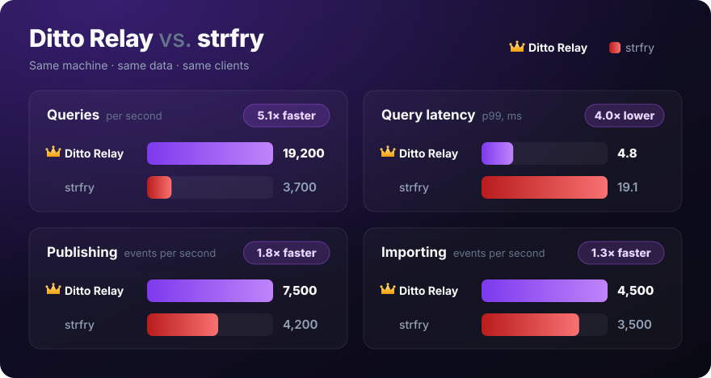

# Ditto Relay

A high-performance [Nostr](https://github.com/nostr-protocol/nostr) relay written in
Rust. It runs on its own database: events are kept as compact binary records in
[LMDB](http://www.lmdb.tech/doc/), with indexes built on its sorted duplicate keys,
and full-text search runs on [Tantivy](https://github.com/quickwit-oss/tantivy).

**Up to 5× faster than strfry**, with a 35% smaller database.
[See the benchmarks.](#benchmarks)

- NIPs 1, 9, 11, 40, 42, 45, 50, 62, 70, and 77
- NIP-50 search with `sort:hot`, `sort:top`, and other extensions, ranked by a web of
  trust seeded from pubkeys you choose
- NIP-45 `COUNT`, with HyperLogLog sketches for large tags
- NIP-77 negentropy syncing, with strfry or any other client that speaks it
- NIP-85 trusted assertions and trending labels, signed by the relay's own key
- strfry-compatible write policy plugins
- Prometheus metrics
- Built-in Tor onion service, off by default

## Installing

Each release publishes static binaries for x86_64 and aarch64 Linux, and `.deb` and
`.rpm` packages, as a [NIP-82](https://github.com/nostr-protocol/nips/blob/master/82.md)
release on Nostr. The packages install the binary, a systemd unit, and
`/etc/ditto-relay/ditto-relay.toml`, and create the `ditto-relay` user and
`/var/lib/ditto-relay`.

Debian and Ubuntu:

```sh
sudo curl -fsSL -o /etc/apt/sources.list.d/ditto-relay.sources https://pkg.soapbox.pub/deb/soapbox.pub/ditto-relay/source
sudo apt update
sudo apt install ditto-relay
```

Fedora and RHEL:

```sh
sudo curl -fsSL -o /etc/yum.repos.d/ditto-relay.repo https://pkg.soapbox.pub/rpm/soapbox.pub/ditto-relay/repo
sudo dnf install ditto-relay
```

Set `url` in `/etc/ditto-relay/ditto-relay.toml`, then:

```sh
sudo systemctl enable --now ditto-relay
```

The relay listens on `127.0.0.1:13131`; put a reverse proxy with TLS in front of it,
or let it serve [HTTPS](#https) itself.
[`CHANGELOG.md`](CHANGELOG.md) says what changed in each release.

## Running from source

```sh
cargo build --release
echo 'url = "ws://127.0.0.1:13131"' > ditto-relay.toml
./target/release/ditto-relay --config ditto-relay.toml
```

Configuration is a TOML file, read from the path `--config` names, or else the first
of `~/.config/ditto-relay/ditto-relay.toml` and `/etc/ditto-relay/ditto-relay.toml`.
[`ditto-relay.example.toml`](ditto-relay.example.toml) lists every setting with its
default; only `url` is required. Data is stored in `data_dir`, by default
`~/.local/share/ditto-relay` (`/var/lib/ditto-relay` as root), along with the relay's
own key, `secret.key`, which is made the first time it starts. `ditto-relay check`
says whether a configuration is valid, and what it would serve, without starting the
relay or opening its database. `ditto-relay config path` says which file is in use,
and `ditto-relay config show` prints the settings in effect, defaults filled in.

## Commands

With no command, `ditto-relay` runs the relay, as `ditto-relay serve` does. The rest
manage it, and are run with the relay's own config, as its user:

| Command | What it does |
| --- | --- |
| `check` | Says whether the config is valid, and what it would serve |
| `config path`, `config show` | The config file in use, and the settings in effect |
| `delete` | Deletes the events a filter matches, or a list of ids ([below](#deleting-events)) |
| `deletions` | Lists the deletions queued, and how far each has got |
| `cancel` | Cancels a queued deletion ([below](#deleting-events)) |
| `export`, `import` | Events out and in, as JSON lines ([below](#exporting-and-importing)) |
| `compact` | Compacts the database, with the relay stopped ([below](#compacting-the-database)) |
| `repack` | Compacts the database while the relay runs ([below](#compacting-the-database)) |

`ditto-relay help <command>` says more about each, with examples. `check` and
`deletions` take `--json`, for scripts.

## HTTPS

```toml
url = "wss://relay.example.com/"

[tls]
enabled = true
```

With TLS turned on, the relay serves `wss://` and HTTPS on port 443 with nothing in
front of it. It gets a certificate for `public_url`'s domain (`url`'s, unless set)
from Let's Encrypt, and renews it in the background, with a third of its lifetime
left, without restarting. Port 80 redirects to HTTPS. The domain's DNS has to point at
the server, and both ports must be open to the internet: Let's Encrypt validates
over 443 (TLS-ALPN-01), or failing that over 80 (HTTP-01). Binding them needs root or
`CAP_NET_BIND_SERVICE`, which the systemd unit grants. Turning TLS on agrees to
[Let's Encrypt's terms](https://letsencrypt.org/repository/). The certificate and the
ACME account are kept in `data_dir/tls`, so a restart serves the certificate at once.
A failed attempt is retried after a minute, then two, and so on up to an hour, and
`ditto-relay check` says when the certificate expires.

## Deleting events

```sh
ditto-relay delete --filter '{"#t":["spam"]}' --dry-run
ditto-relay delete --filter '{"kinds":[1]}' --age 7776000
```

`delete` removes every stored event a NIP-01 filter matches, as `strfry delete` does.
The filter matches as a REQ's would, NIP-50 search text and extensions included, so
`{"search":"protocol:atproto"}` deletes every bridged Bluesky event. A filter with a
`limit` or `distinct:author` deletes the events it picks as of then: with `sort:top`
and a limit, the most engaged with. `--age` only removes events at least that many
seconds old. `--dry-run` only counts them, and only reads, so it never holds up the
relay. Run it with the relay's own config, as the relay's user.

`delete --ids <file>` deletes the events whose ids are listed in the file, in hex, a
line each, or with `-`, on stdin, however many there are, as one deletion. Deleting
millions of events found some other way, as by putting each to a write policy
plugin, is best done so: as one deletion, it sweeps each index once, where many
smaller ones would each remove their events one at a time.

While the relay is running, `delete` returns as soon as the relay has queued the
deletion, and from then on, no client sees what it matches, however many events that
is. The relay removes them afterwards, in the background, between its own writes,
deleting flat out while it has nothing else to write and at most half the time while
it does, and says how it's going in its log. A deletion of hundreds of thousands of
events or more sweeps each index once, in order, rather than removing every event
from twenty places at random. A queued deletion survives a restart, and goes on where
it left off. Only events stored before it was asked for are deleted. Counts the relay
answers from its indexes alone include them until they're gone.

NIP-09 deletions and NIP-62 requests to vanish are queued the same way: what they
name is hidden as soon as they're stored, and removed after.

With the relay stopped, `delete` removes the events itself, then and there, and a
relay started meanwhile waits for it to finish. Removing an address's current version
also removes its older versions that the filter matches, and the newest version left
becomes current. Nothing stops deleted events from being published again.

`ditto-relay deletions` lists the deletions queued and not yet done, of every kind,
with how far removing each has got. It only reads, so it's safe while the relay runs.

`ditto-relay cancel <id>` cancels one of them, by the id `deletions` lists it under,
and leaves the rest queued. What it's removed already stays removed, and what it
hasn't is shown again. A NIP-09 deletion or a request to vanish can be cancelled too,
though the relay goes on refusing what it names if it's published again. A deletion
sweeping the indexes can't be stopped partway, since only finishing leaves them whole.

## Exporting and importing

```sh
ditto-relay export > backup.jsonl
ditto-relay export --filter '{"authors":["<hex pubkey>"]}' | gzip > alice.jsonl.gz
ditto-relay -c old.toml export | ditto-relay -c new.toml import
ditto-relay import backup.jsonl
```

`export` writes stored events to stdout, an event a line, as clients would see them:
not those expired, nor those a pending deletion covers. Without `--filter`, it writes
every event, old versions of replaceable events kept as history too; with one, what
the filter matches, as `delete` would find it. Events come out in the order they were
stored. It only reads, a transaction of 10,000 events at a time, so it's safe while
the relay runs, and doesn't keep its writer from reusing pages.

`import` stores events read as JSON lines, from a file or stdin, as a client's would be
stored, in the order they're read, so a replaceable event's versions, and NIP-09
deletions and what they delete, come out as they first did. Each event's id and
signature are checked, unless it's stored already (`--no-verify` skips that, for
events you trust), but they aren't put to the write policy plugin. Ephemeral events
aren't stored. While the relay runs, it's sent the events and stores them itself, and
its subscribers see them; with it stopped, `import` stores them there and then, and a
relay started meanwhile waits for it. At the end, it says how many were stored, and
why any were refused.

## Compacting the database

```sh
systemctl stop ditto-relay
sudo -u ditto-relay ditto-relay compact
systemctl start ditto-relay
```

LMDB never shrinks its file. After deleting much of the database, what's left is
spread thinly through a file many times its size, so less of it stays in memory and
the relay reads the disk more. `compact` rewrites the database's indexes into a new
file, packed in order, and puts it in place. It needs the relay stopped, and room for
the new file, which is about the size of what's live. The old file is kept beside it,
as `db/data.mdb.old`: remove it once the relay runs well on the new one. Event records
(`db/bodies`) are written in order and kept packed already, so they're left alone,
unless a file written anew would suit ZFS better (see below). Then they're copied as
they are, and the old file is kept as `db/bodies/data.mdb.old`.

`compact --bodies` compacts the event records too, keeping their old file the same
way. Deleting many events fragments them: what's freed is single pages scattered
through the file, which a record bigger than a page can't use, so the file grows
while its freelist piles up.

It reads with 32 threads at once, as the live pages of a big file are scattered, and
waiting on them one at a time is what makes `mdb_copy -c` slow. `--threads` changes
how many. `compact --from <dir> --into <dir>` only copies the database in `--from`,
which must be stopped or a snapshot, into `--into`, to see how long it takes.

### While the relay runs

```sh
sudo -u ditto-relay ditto-relay repack
sudo -u ditto-relay ditto-relay repack --bodies
```

`repack` compacts the indexes as `compact` does, or with `--bodies` the event records
instead, while the relay goes on serving. The relay makes the copy itself, reading
the database as it was when it began. What it writes meanwhile goes to the old file as
usual, and is also kept in a journal that the copy catches up from. Once the copy has
caught up, the relay's writes wait for about a second while the last of them is
copied, and the copy replaces the old file. Reads already under way finish on the old
file. It's kept in `db/repack-old/` (or `db/bodies/repack-old/`) until they're done,
then freed a little at a time from its end, and removed: on ZFS, removing a file of
hundreds of gigabytes at once holds up every write until its blocks are freed, which can
take many minutes. Nothing is left to clean up. Sweeps of big deletions wait while a
repack runs, as each entry they remove would be copied too. If the copy can't catch up
with what's written, or there's more left to copy than the writer can wait for, the
repack gives up and leaves the old file in place.

It needs room for the copy, for what's written meanwhile, and for the old file to grow
while the copy reads it, since LMDB can't reuse the pages the copy is reading: it
refuses to begin without about 110% of the file's used size free. It reads
ahead with 8 threads, fewer than `compact`, to leave the disk to the relay;
`--threads` changes that. If the relay or the machine stops before the copy is in
place, the database is as it was, and the half-made copy in `db/repack/` is freed the
same way when the relay starts, as is an old file not yet freed. With the relay stopped, `repack` runs by itself, and a relay
started meanwhile waits for it.

## Storage

The database works on any filesystem. On ZFS, its dataset's `recordsize` should be
4K, LMDB's page size. ZFS never changes part of a record in place, so in bigger records
it reads a record from disk before each page the relay writes into it, and writing is
many times slower: on SATA SSDs, about 2,000 pages a second in 16K records, against
77,000 in 4K. The relay checks this at startup and in `ditto-relay check`, and says
which dataset to change. A file keeps the records it was written in, so after
`zfs set recordsize=4K <dataset>` (on the host, for a container), stop the relay and
run `ditto-relay compact`, which writes the files anew.

The same goes for a VM's disk kept on a ZFS zvol: its `volblocksize` should be 4K too.
The relay can't see that from inside the VM.

## Tor

```toml
[tor]
enabled = true
```

With Tor turned on, the relay is a Tor onion service too. Tor is built in (it's
[Arti](https://arti.torproject.org/)), so there's nothing else to install or
configure. The onion's address is logged at startup, and it answers about a minute
later, once Tor has published it. The key the address is made from is kept in
`data_dir/tor/hs_ed25519_secret_key`, in C Tor's format: back it up to keep the
address, or put an existing onion's `hs_ed25519_secret_key` there to keep that one.
[`ditto-relay.example.toml`](ditto-relay.example.toml) lists the rest of the settings,
including Arti's own.

## Benchmarks



| | Ditto Relay | strfry | |
| --- | --- | --- | --- |
| Queries/s, 16 connections | 19,200 | 3,700 | **5.1× faster** |
| p99 latency, 16 connections | 4.8 ms | 19.1 ms | **4.0× lower** |
| p99 latency, 1 connection | 1.8 ms | 6.0 ms | **3.4× lower** |
| Queries/s, 1 connection | 4,800 | 1,500 | **3.1× faster** |
| Events/s published to live subscribers | 7,500 | 4,200 | **1.8× faster** |
| Events/s imported | 4,500 | 3,500 | **1.3× faster** |
| Database size | 7.8 GB | 12 GB | **35% smaller** |

Same machine, same clients, 2 million real events and 33,613 real `REQ`s from
relay.ditto.pub, against [strfry](https://github.com/hoytech/strfry) `4cd3cf6`.

## License

[GNU Affero General Public License v3.0 or later](LICENSE).
